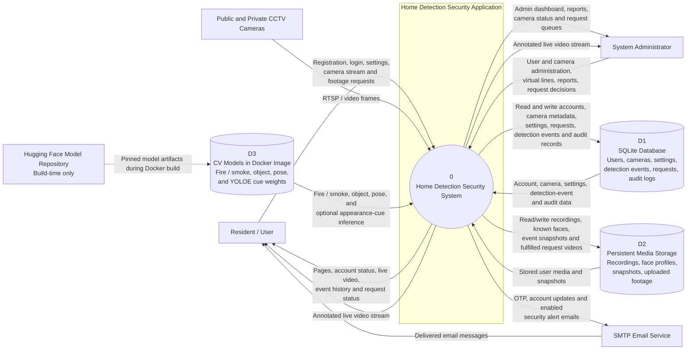

# Home Detection Security — Level 0 DFD

This context-level data flow diagram shows the application's boundaries, its
external entities, and the main data exchanges. It reflects the Flask
application, its SQLite database and persistent media storage, CCTV inputs,
and SMTP email delivery.

See [system-architecture.puml](./system-architecture.puml) for the component
architecture diagram. See [agile-development-process.md](./agile-development-process.md)
for the project's iterative development process diagram.

## Data-scope notes

- User event pages and the user events API query computer-vision events by the
  signed-in user's `user_id`; they do not show other users' event records.
- Detection events and audit records are stored in separate tables, with
  independent ID sequences. Admin reports query detection events; the admin
  audit-log page queries audit records. Schema initialization splits records
  from the former combined event table into their corresponding tables.
- Public camera streams share one processing worker. The worker is created
  under the camera owner's identity, so detections from a public camera are
  logged to the owner's event history. Admin reports still include those
  events in the system-wide view.
- Railway's persistent volume should be mounted at `/app/storage` to cover
  both the SQLite database (`storage/instance/`) and user media
  (`storage/users_data/`). The model files are downloaded at image-build time,
  not stored in that volume.
- The Docker image downloads pinned fire/smoke, object-detection, pose, and
  YOLOE appearance-cue weights from Hugging Face. It sets
  `BEHAVIOR_POSE_MODEL=models/pose/yolo26m-pose.pt`; the pose weights are
  therefore available to behavior analytics, and the YOLOE weights are saved
  as `yoloe-26s-seg.pt` to match the concealment scanner's default model path.
- The YOLOE appearance-cue scan looks for face-covering and headwear cues in
  person crops. It runs only when `CONCEALMENT_CUE_THRESHOLD` is configured;
  the weights are included in the image even when scans are disabled.
  `CONCEALMENT_CUE_MODEL` can override the bundled default model path.
- Flask and computer-vision workers currently run together in the same Railway
  Docker service. They have not yet been split into independently deployed
  services.
